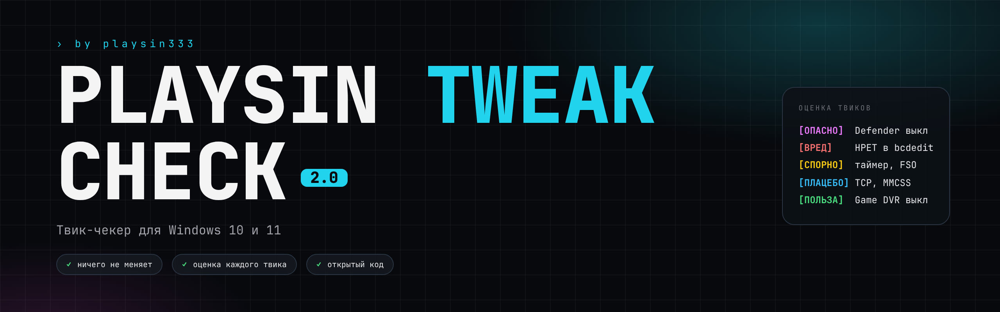
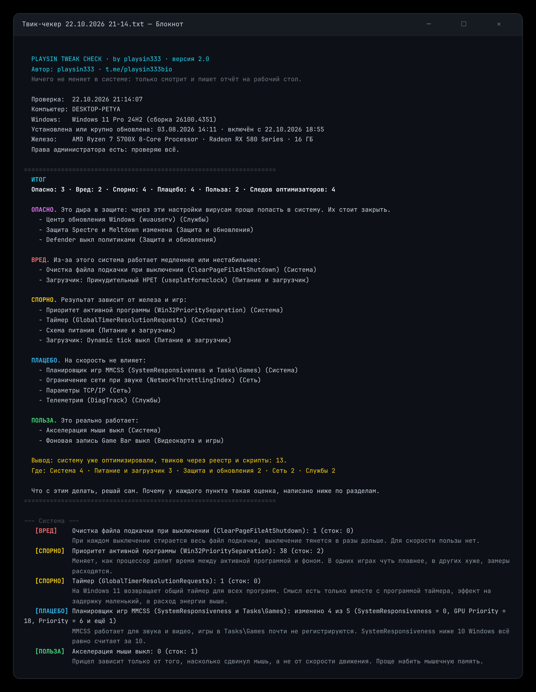

  

  
  
  
  
  

<h3 align="center">Проверь, оптимизировали ли уже твою Windows. За минуту, без установки и ничего не меняя.</h3>

  

---

Твик-паки, «бустеры FPS», батники с YouTube, оптимизаторы вроде Process Lasso или Razer Cortex, сборки Windows «для игр». После них в системе остаются изменённые значения реестра, отключённые службы, свои схемы питания и бэкапы. Снаружи этого не видно, а PLAYSIN TWEAK CHECK находит всё это и честно оценивает каждую изменённую настройку: даёт ли она реальную пользу, ничего не делает, зависит от железа, тормозит систему или открывает дыру в защите.

На чистой Windows чекер ничего не найдёт. На оптимизированной покажет, что именно поменяли, где и что из этого работает, а что нет.

## Как это выглядит

  

## Как запустить

1. Скачай [**PLAYSIN-TWEAK-CHECK.zip**](https://github.com/playsin333/windows-tweak-checker/releases/latest/download/PLAYSIN-TWEAK-CHECK.zip) и распакуй.
2. Запусти `PLAYSIN TWEAK CHECK.bat` двойным кликом.
3. Windows спросит права администратора, нажми «Да». С ними видно загрузчик, точки восстановления и исключения Defender. Если нажать «Нет», проверка всё равно пройдёт, только без этих пунктов.
4. Через минуту отчёт ляжет на рабочий стол файлом `Твик-чекер <дата>.txt` и сам откроется в блокноте. В нём итог и разбор каждого пункта с объяснением.

> [!TIP]
> Если SmartScreen пишет «Windows защитила ваш компьютер», нажми «Подробнее», потом «Выполнить в любом случае». Так Windows реагирует на любой батник из интернета без цифровой подписи. Код открыт, его можно прочитать прямо здесь перед запуском.

## Как читать результат

Каждая изменённая настройка получает оценку, а под ней одной строкой написано, почему.

| Метка | Что значит |
|:--|:--|
|  | Реально даёт производительность или снижает задержку |
|  | Ничего не меняет или эффект на уровне погрешности. Обычно твики из времён Windows XP |
|  | На одном железе и в одних играх помогает, в других мешает |
|  | Вредно для производительности: система от этого медленнее или нестабильнее |
|  | Вредно для безопасности: на скорость почти не влияет, но открывает систему вирусам и атакам |
|  | След оптимизатора: бэкап, точка восстановления, папка, `.reg`-файл, программа, задача в планировщике |
|  | Как в чистой Windows |

В консоли идёт только ход проверки и счётчики по разделам. Всё остальное в отчёте: сверху итог со списком опасного, вредного, спорного, плацебо и пользы, ниже разбор по разделам. Советов, что включить, чекер не даёт: он показывает, что у тебя есть, а решаешь ты сам. Исключение одно: если нашлось опасное, он прямо скажет, что это дыра и её стоит закрыть.

Ещё в итоге есть вывод, оптимизировали ли систему: **нет**, **почти чистая** (1–3 точечные правки), **твиков почти нет, но оптимизаторы были** (откатили или не доделали) и **систему уже оптимизировали**, с разбивкой, где именно.

## Что проверяется

| Раздел | Что смотрит |
|:--|:--|
| **Система** | Win32PrioritySeparation, MMCSS и Tasks\Games, приоритеты через IFEO, MenuShowDelay, Power Throttling, svchost, LargeSystemCache и Prefetch, NTFS, GlobalTimerResolutionRequests, очередь мыши и клавиатуры, сжатие памяти, файл подкачки |
| **Видеокарта и игры** | Game DVR, оптимизация во весь экран (FSO), TdrDelay, игровой режим, HAGS и MSI mode для сведения |
| **Питание и загрузчик** | схема питания, свои и импортированные схемы, гибернация, быстрый запуск, `bcdedit`: dynamic tick, HPET, tscsyncpolicy, гипервизор, DEP |
| **Сеть** | NetworkThrottlingIndex, Nagle, параметры TCP/IP, автонастройка окна TCP, QoS, настройки драйвера сетевой карты в сравнении со стоком самого драйвера |
| **Телеметрия и реклама** | политики телеметрии, Bing в поиске, Copilot, Recall, виджеты, политики Edge и Chrome, задачи телеметрии в планировщике |
| **Службы** | около 60 служб, которые любят отключать: телеметрия, Xbox, печать, Bluetooth, Hyper-V, SysMain, поиск и отдельно опасные (обновления, Defender) |
| **Защита и обновления** | UAC, VBS, Spectre и Meltdown, Defender и его политики, SmartScreen, политики и пауза обновлений |
| **Приложения** | массовое удаление встроенных приложений, Microsoft Store, Edge |
| **Следы** | бэкапы паков, папки и файлы оптимизаторов, `.reg`, `.nip` и `.pow` файлы, установленные и запущенные программы, задачи планировщика, точки восстановления, ярлыки откатов, сборки Windows, файл hosts |

Полный список со стоковыми значениями лежит в [docs/CHECKS.md](docs/CHECKS.md).

## Почему ему можно доверять

- **Только чтение.** В коде нет ни одной записи в реестр, службы или задачи. Единственный файл, который создаётся, это отчёт на рабочем столе.
- **Без установки и интернета.** Один `.bat`, внутри обычный PowerShell, ничего не скачивает и никуда не отправляет.
- **Открытый код.** Всё в одном файле: [`PLAYSIN TWEAK CHECK.bat`](PLAYSIN%20TWEAK%20CHECK.bat).
- **Проверяется на настоящей Windows.** Каждое изменение автоматически прогоняется на Windows в [GitHub Actions](https://github.com/playsin333/windows-tweak-checker/actions).

## Вопросы

<b>На моей чистой Windows нашлось 1–2 твика. Это ошибка?</b>

 
Не обязательно. Производители ноутбуков и некоторые программы меняют пару значений сами, а сборки Windows немного отличаются друг от друга. Поэтому 1–3 правки чекер считает «почти чистой системой». Если уверен, что систему никто не трогал, а чекер нашёл твик, <a href="https://github.com/playsin333/windows-tweak-checker/issues/new?template=false-positive.yml">напиши об этом</a>, поправлю сток.

<b>Почему мой твик помечен как плацебо?</b>

 
Плацебо значит, что на современной Windows этот твик не даёт измеримого прироста: он остался со времён старых систем или влияет на то, что игры не используют. Почему именно, написано в отчёте под самим пунктом. Где результат реально зависит от железа, стоит «спорно», а не «плацебо». Если у тебя есть замеры, где твик даёт разницу, <a href="https://github.com/playsin333/windows-tweak-checker/issues/new?template=new-check.yml">пришли их</a>, пересмотрю оценку.

<b>Чекер может что-то сломать?</b>

 
Нет. Он только читает. Можно запускать сколько угодно раз, на любом ПК.

<b>Зачем права администратора?</b>

 
Без них Windows не даёт прочитать загрузчик (<code>bcdedit</code>), точки восстановления, исключения Defender и настройки менеджера памяти. Остальное проверяется и без прав.

<b>Работает на Windows 7 или 8.1?</b>

 
Нет, только Windows 10 и 11. На старых версиях другие стоковые значения, и проверка врала бы.

<b>Нашёл оптимизатор, который чекер не видит</b>

 
<a href="https://github.com/playsin333/windows-tweak-checker/issues/new?template=new-check.yml">Предложи проверку</a>: название оптимизатора, что он меняет и какие следы оставляет.

## Автор

Сделал **playsin333**: оптимизирую Windows под игры и снимаю про это.

Если чекер пригодился, поставь ⭐, так его найдут другие.

Распространяется по лицензии [MIT](LICENSE).

#оптимизация_windows #твики #твик_чекер #fps #инпут_лаг #input_lag #windows_tweaks #windows_optimization #fps_boost #gaming #windows10 #windows11 #debloat #telemetry #powershell #batch #regedit #process_lasso #timer_resolution #msi_mode #mmcss #game_mode #optimization_checker #tweak_checker
